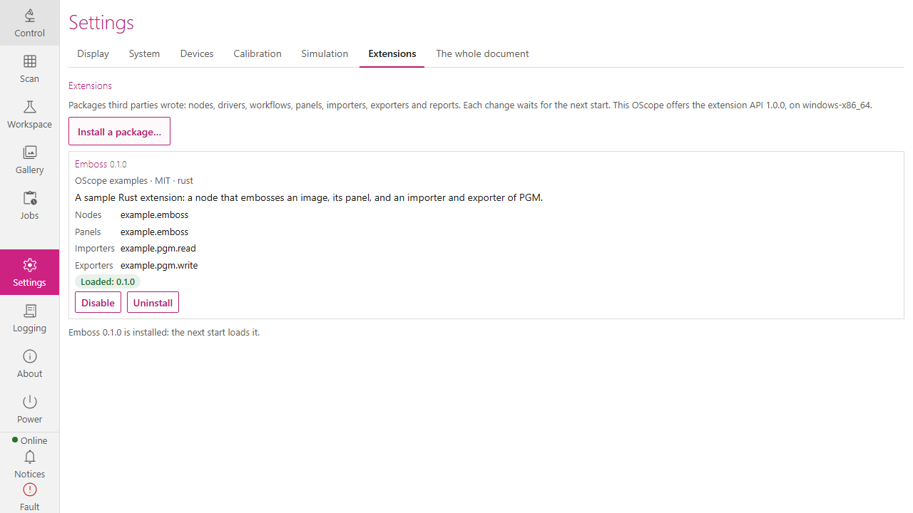
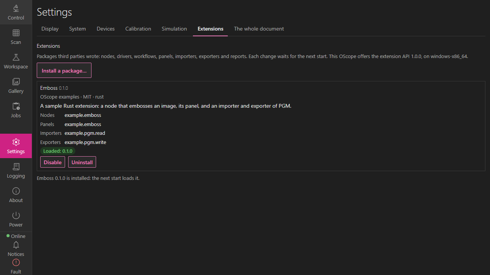
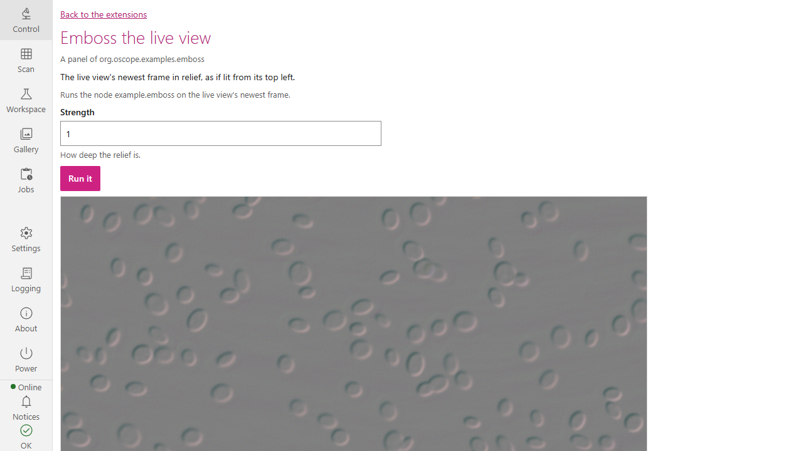
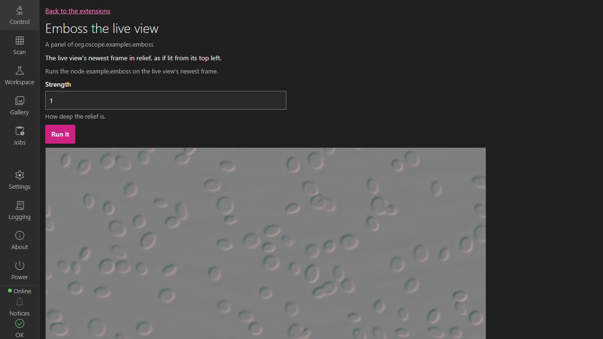

# W8.5: Extensions and their panels

- Status: In review
- Branch / PR: `m2/w8.5-extensions` / [#134](https://github.com/lucaswewa/OScope/pull/134)
- Estimate: first 1,700, the spec's · second ~2,200 (code ~1,090, tests ~310, styles ~140, try-it ~600, glue ~60), in the plan's change log before the code, 29 % over the first · measured 1,386 (code 699: the server's 220, the app's 479; styles 141; tests 215; try-it 283; glue 48), 37 % under the second

## Summary

Installing what third parties wrote, and using the panels it describes ([spec](../phases.md#w8-5), D11, ADR-0036), in a seventh view of the Settings tab, *Extensions*:

- **Installed:** each package, with its publisher, licence and kind, what it brings (its nodes, drivers, workflows, panels, importers, exporters and reports), and where it stands: loaded, loaded at the next start, disabled, uninstalled at the next start, or why it didn't load. The extension API this OScope offers, and its platform.
- **Changing them,** with the lease: a package installed by uploading its `.omext`, with its progress; each enabled, disabled or uninstalled. What waits for a restart is said, and the restart offered on Power.
- **Panels:** each at a route of its own under its extension, `#/settings/extensions/<extension>/<panel>`, drawn from its description:
  - a form from its schema, through W0.6's SchemaForm;
  - what it submits to: one of the extension's nodes, run on the live view's newest frame, or a Thing's action;
  - its answer, as an image, a table, JSON or text.
- **The app runs no code from an extension:** a panel is data. A construct in it the app doesn't know is said: a field the form can only show as JSON, or a submission or view of a kind it doesn't know, which draws no panel.

## What was built

In `web/src/features/settings/extensions/`:

- **`ExtensionsPane.vue`:** the view, through the `extensions` Thing's `installed`, `panels`, `host` and `restart_needed`, its `enable`, `disable` and `uninstall`, and its `install` route.
- **`PanelPage.vue`:** a panel, from `panel/{name}`, at its route, which `app/router.ts` adds.
- **`panel.ts`:** a panel's description read and checked for what the app draws, and an answer turned into what its view shows.

`SettingsTab.vue` opens a view named by `?view=`, which a panel's page links back to.

**The server:** `POST /api/v1/preview/run_node`, `{"node", "params"}`, runs a node once on the live view's newest frame (`run_node.rs`). This is how ADR-0036's panels submit to a node, which nothing did yet: the `pipeline.batch` job keeps image outputs only, as files no route serves.
- **The run:** the frame, in linear light as live recipes see it, goes to each of the node's image inputs.
- **The answer:** each output, by its port. An image is a PNG in base64, no longer than 1,024 on its longest side, each pixel a block's mean. A table is its columns and rows; any other JSON is as it is.
- **Refusals:** 400 for a node that isn't, parameters its schema refuses, or a node with no image to take; 503 with no frame in 10 s.

**The sample Rust extension,** `ext-rust-node`, has a panel now, `example.emboss`, which the try-it opens: a form of the node's strength, submitted to `example.emboss`, shown as an image. `ex-rust-ext` packs it, and `ex-rust-ext --pack OUT` makes the package alone, which the end-to-end tests install.

## How to try it

On the CUDA build, as W6's notes say:

```sh
cargo build --release -p oscope-server --features cuda
npm --prefix web ci && npm --prefix web run build
cargo run -p ex-rust-ext -- --pack emboss.omext
target/release/oscope-server --config configs/oscope.toml --port 8211 --web web/dist
```

1. **Open Settings, then *Extensions*:** *Install a package…*, `emboss.omext`. *Emboss 0.1.0 is installed: the next start loads it*, and the restart is offered on Power.
2. **Restart from Power,** and come back: *Loaded: 0.1.0*, with its node, its panel, its importer and its exporter. `example.emboss` is among the live recipes' nodes too.
3. **On Control,** start streaming over the tissue. **Back in *Extensions*, open *Emboss the live view*:** set its strength, and *Run it*. The newest frame comes back in relief.
4. **Uninstall it:** it goes at the next start, which the page says.

## Screenshots

| | Light | Dark |
|---|---|---|
| The extensions, the sample loaded |  |  |
| Its panel, and the node's answer |  |  |

## Design notes and deviations from the plan

- **The node's run is server work** the spec didn't name: ADR-0036 has panels submit to a node on the live view's newest frame, and no route did that. It is on the `preview` Thing, which has the frames, the engine and the extensions' nodes, as live recipes do. It is a route, not an action, so that an image answer isn't kept in an invocation's record.
- **The sample Rust extension gained a panel,** as the try-it opens it, and `ex-rust-ext` packs a sample's panels with it. Its server test lists the panel among what it provides, and its test of a manifest that names another node renames only the node, the panel left out.
- **The end-to-end tests build the sample** where their server is built, with `cargo build -p ext-rust-node -p ex-rust-ext`, then pack it with `ex-rust-ext --pack`. On a build folder that has them already, that is a moment.
- **A panel's answer is shown by its view:** the first image, or table, the node gave for those views; for JSON and text, all of it. An action's answer is its output.
- **A description with a construct the app doesn't know** is said above the panel. The server refuses at install a panel whose form its checks refuse (ADR-0036), so the end-to-end tests can't install one: the unit tests say it.
- **A panel's page is outside the Settings tab,** at its own route, so the rail doesn't mark Settings there. *Back to the extensions* opens the view again.

## Tests

- **The server:**
  - over HTTP, 1 new: a node run once on the newest frame. Without a frame, 503. A Gaussian blur's image is answered as a PNG of the frame's size; the histogram's tables, as columns and rows. Refused: a node that isn't, a sigma past its schema, a node with no image to take, and no node;
  - a unit test: an image longer than 1,024 made smaller by its blocks' means, one small enough kept, and the PNG in base64.
- **`ex-rust-ext`:** its server test and smoke run, and `ex-checkpoint-b`'s, with the panel in the package.
- **Unit, 5 new:**
  - each sample extension's panel drawn: the Rust sample's, the Python node's and the hello extension's, their forms, nodes and views;
  - one submitting to a Thing's action;
  - a view, a submission and a description it doesn't know, said, and no panel drawn; a field the form can only show as JSON, said;
  - a node's image and table answers shown;
  - text and JSON shown.
- **End to end, `extensions.spec.ts`, 3 new, 1 visual and 1 for the notes' screenshots,** in Chromium, the first in Firefox and WebKit too:
  - the sample packed, installed by upload, waiting for the restart, restarted, loaded with its node among the live recipes'. Its panel opened at its route, with the form from its schema. Run at strength 0, it answers a flat grey of 0.5; at strength 3, the tissue in relief. Back, and uninstalled at the next start;
  - a package that isn't one, refused;
  - axe, in both themes;
  - the view's baseline, and the Settings, Calibration and Simulation views' again, as the tab list grew, on Windows and Linux, each passing 3 of 3.

  The first also ran under WSL, its sample built and loaded on Linux.
- **Found by its own tests:**
  - the panel's page stopped as it opened: its first reading reset the answer before the answer was declared;
  - the test of the panel's answer passed whatever the form held, as any strength gives grey. It runs strength 0, flat, then 3, in relief;
  - the shrinking of a large answer was untested: the fake camera's frames are smaller than 1,024. A unit test does it.
- **Found by its gate:** the Linux replay on `c4eef6e` failed this phase's own test in WebKit. After the restart, it loaded the page as the old server exited, before the new one listened: the test server's count of restarts rises at the exit. The test waits for the server's `/health` now. Fixed in the next commit, it passed 5 of 5 on two CPUs on Windows, and 15 of 15 under WSL, each browser 5 times.
- **Mutation checks, 14, all caught, none hung:**
  - in the server: the frame to no image input, an image answered whole, a table not answered as one, and no frame a server error;
  - in the panel's reading: any view taken, an action's submission not read, a field shown as JSON not said, an image not a data address, and a node's table not looked into;
  - in the browser: a panel's link by its title, the form's values not sent, the answer never shown, the package sent elsewhere, and an uninstalled one said otherwise.
  - An image answered whole survived the first run, which led to the unit test.
- **The try-it,** on the debug server: `extensions.spec.ts`, its screenshots among it.
- **W2.1's `shell.spec.ts`** failed once in Firefox in a local run of the neighbouring specs, the Scan tab's heading, as in W8.3's gate; 5 of 5 alone.
- **Two cores, five times,** on `c4eef6e`: `oscope-api`'s preview and unit tests, `ex-rust-ext`'s server test and smoke run, `ex-checkpoint-b`'s, every unit test (130.9–141.4 s), and every spec (2,955–3,067 s). All passed 5 of 5 but the specs, 4 of 5. The fifth run failed an earlier phase's test: W3.6's `values.spec.ts` in Chromium, its saturated pixels' mean a near tie with the rest's (254.2 against 253.6). That spec, run five times again on two CPUs, passed 5 of 5 (165.2–177.5 s). As the owner chose, it is named and merged past.
- **The replays:** the merge gate (ADR-0038), only what the change reaches (ADR-0061): `oscope-api`, `oscope-server`, the examples on them, `ex-rust-ext` and `ext-rust-node` among them, every unit test, and every spec, as the server and the API's types changed.
  - **On `c4eef6e`, Windows** passed 64 of 65 steps in 24 min, with 145 Rust tests; 419 of 424 end-to-end tests passed, while memory ran short (6.8 GB at the least), Firefox saying its compositor couldn't map its framebuffer. Its five failures were earlier phases':
    - W1.1's `api.spec.ts` and W7.4's `analyses.spec.ts`, already named;
    - W7.2's `editor.spec.ts` and W7.5's `annotate.spec.ts` in Firefox;
    - W8.4's simulation baseline, a few pixels of a badge's edge and the rail's icons.

    The five specs, run five times again on two CPUs, passed 5 of 5 (297.7–309.8 s), and none had failed in the five runs above. As the owner chose, they are named and merged past.
  - **Linux,** on a fresh clone of `c4eef6e`, run alone after the Windows replay: 64 of 65 steps in 15 min, with 146 Rust tests; 424 of 425 end-to-end tests passed. Its one failure was this phase's own, above, and blocked the merge.
  - **On RERUN, after the fix:** AFTER
- **Docs:** the relative links and anchors in the Markdown files resolve.

## Follow-ups and known gaps

- **A panel submitting to a node of another extension, or to a stock node,** runs too: the route runs any node the live recipes may use. ADR-0036 has panels submit to their own extension's, which the server checks at install.
- **A panel's answer as a chart** would be a view ADR-0036 doesn't have.
- **The rail** could mark Settings on a panel's page.

## Clean room

Nothing was copied from `microscope` or any other codebase. No dependency was added.
