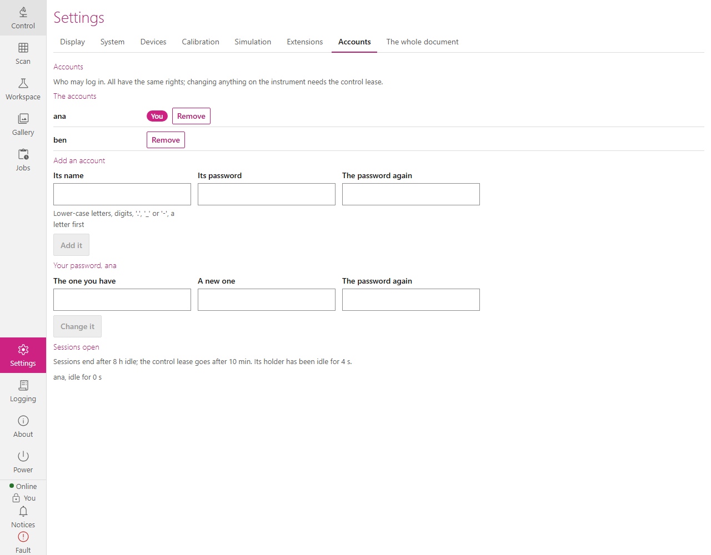
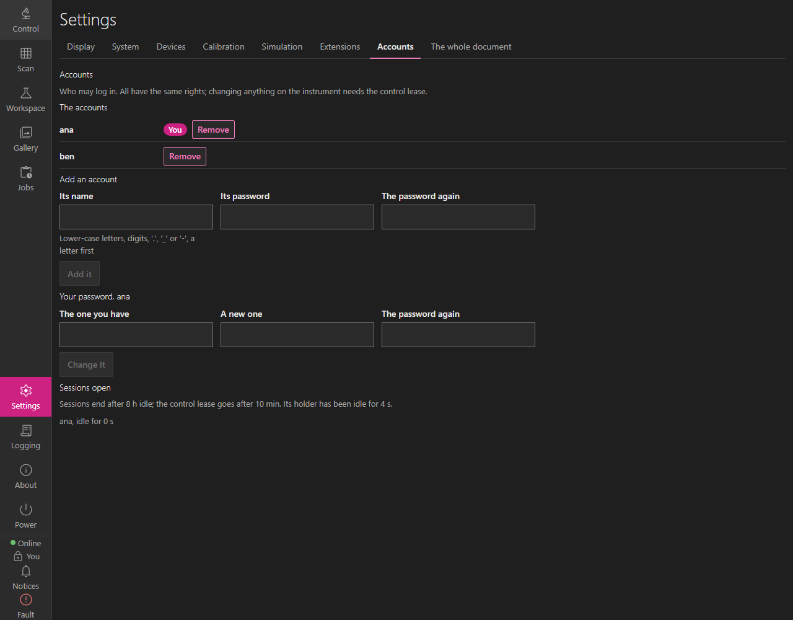

# W8.6: Accounts

- Status: In review
- Branch / PR: `m2/w8.6-accounts` / #PR
- Estimate: first 1,400, the spec's · second ~1,750 (code ~820, tests ~380, styles ~110, try-it ~380, glue ~60), in the plan's change log before the code, 25 % over the first · measured 1,231 (code 593: the server's 304, the app's 289; styles 60; tests 338; try-it 240), 30 % under the second; the `accounts` Thing's description snapshot, 327 lines, generated, left out

## Summary

Accounts kept from the app, where M1 had only the command line ([spec](../phases.md#w8-6), D22, [ADR-0055](../../adr/0055-accounts-over-the-api.md)), in an eighth view of the Settings tab, *Accounts*:

- **The accounts,** listed, added and removed, with the lease. A name the server wouldn't take, or a password too short or typed differently twice, is said at its field before anything is sent. Removing one asks first, and says when it is one's own.
- **One's own password,** changed with the old one, without the lease.
- **Security at the next start:** the first account, on a server without, turns it on, and the last, removed, turns it off. The page says so, and offers the restart on Power. An open server says that anyone who reaches it may use it.
- **The sessions open,** each its account and how long it has been idle, and the idle times: how long a session may be idle, the lease too, and how long the lease's holder has been.

**The server's change, which the spec names:** an `accounts` Thing, served with security or without (ADR-0055).
- **What it reads:** the accounts' file the server reads at its start. With security on, those are the very accounts logins are checked against, so an account added logs in at once.
- **The rules:**
  - adding and removing need the lease;
  - the last account can't be removed while the next start listens on the network, as the configuration file says;
  - an account removed ends its sessions;
  - one's own password is changed with the old one, without the lease.

## What was built

In `web/src/features/settings/accounts/`:

- **`AccountsPane.vue`:** the view, through the `accounts` Thing, and the session's own name, for one's own password.
- **`accounts.ts`:** a new account's name and password checked as the server checks them, a password counted in characters; and an idle time in words' parts.

The server:

- **`accounts.rs`:** the `accounts` Thing: `names`, `secure`, `restart_needed`, `sessions` and `idle`; `add`, `remove` and `change_password`.
- **`auth.rs`:** security says its accounts, the sessions open without their tokens, and the idle times, and ends an account's sessions. One's own password is free of the lease, as one's own display preferences are. The accounts' file's name, `accounts.json`, is `oscope-api`'s now, which `oscope-server` re-exports.
- **ADR-0055,** *Accepted* with this pull request, and its row in the index.

## How to try it

On the CUDA build, as W6's notes say, on a configuration whose data root has no `accounts.json`:

```sh
cargo build --release -p oscope-server --features cuda
npm --prefix web ci && npm --prefix web run build
target/release/oscope-server --config configs/oscope.toml --port 8211 --web web/dist
```

1. **Open Settings, then *Accounts*:** *This server has no accounts*. Add `ana` with a password typed twice: *ana is added*, and *Security turns on at the next start*.
2. **Restart it from Power,** under a supervisor that starts it again (ADR-0060), and open the app again: it asks for the login. Log in as `ana`.
3. **Take control,** then add `ben`, and remove him: asked first, then *ben is removed*, and he can't log in.
4. **Change your password,** with the old one: a wrong old one is refused.
5. **Under *Sessions open*:** `ana`'s, and how long it has been idle; sessions end after 8 h idle, the control lease after 10 min.

## Screenshots

| | Light | Dark |
|---|---|---|
| The accounts, one's own password, and the sessions open |  |  |

## Design notes and deviations from the plan

- **A Thing of its own, served always** (ADR-0055): the `auth` Thing is served only with security, so a server without accounts had nowhere to add its first. The `settings` Thing keeps what the next start reads; an account added logs in at once.
- **Security still waits for a restart,** which the page says and offers: turned on mid-run, every open page would be locked out at once.
- **The last account's rule reads the configuration file,** what the next start listens on. Without a file, the last account may go.
- **Removing one's own account ends one's own session:** the page warns, and asks for the login after.
- **The app opened again after a restart** asks the server whether it has security. A page left open finds out at its next request, as W1.3's do.

## Tests

- **The server, 4 new:**
  - on a server without security: no accounts, sessions or idle times. A name and passwords the store refuses are refused. The first account is kept in the file the next start reads, and waits for that restart. A second of the same name is refused, and a password change without a login. Removed again, nothing waits;
  - on a secured one: without the lease, refused; with it, an account added, which logs in at once. Both sessions are listed, and the idle times read. A password with the wrong old one is refused, and with the right one changed. An account removed ends its session;
  - the last account kept while the next start listens on the network, then removed once it is this computer alone, its caller's session ending with it;
  - its description.

  W1.3's test of every action that changes state knows one's own password needs no lease.
- **Unit, 3 new:** a new account's name and password, and an idle time in words.
- **End to end, `accounts.spec.ts`, 3 new, 1 visual and 1 for the notes' screenshots,** in Chromium, the first in Firefox and WebKit too, and run under WSL:
  - on an open server, the first account added and the next start's security said; restarted, the app asks for the login, and `ana` is in, with her session and the idle times;
  - on a secured one, with the lease: a name refused at its field, an account added, another removed after asking, and logging in with each checked; one's own password, the wrong old one refused, then changed;
  - axe, in both themes;
  - the view's baseline, and five views' again, as the tab list grew, on Windows and Linux, each passing 3 of 3.
- **Found by its own tests:**
  - removing never ran: the dialog closed before it said it was confirmed, and closing cleared the account to remove;
  - an account removed was its caller's own in the server test, which then couldn't read its answer: its session had ended. The test reads the file;
  - WebKit, logging in after the restart, went to Control: the test opens the view after logging in, wherever the login goes.
- **Mutation checks, 14, all caught, none hung:**
  - in the server: the restart said the wrong way, the last account removed on the network, a removed account's sessions kept, the old password not checked, one's own password needing the lease, and no session listed;
  - in the checks: a name of any length, `local` a name, a password counted in UTF-16, and a minute said in seconds;
  - in the browser: the new account's password not sent, an account never removed, one's own password not offered, and the restart never said.
- **The try-it,** on the debug server: `accounts.spec.ts`, its screenshots among it.
- **Two cores, five times:** TWOCORE
- **The replays,** in full for Checkpoint L: REPLAYS
- **Docs:** the relative links and anchors in the Markdown files resolve.

## Checkpoint L

An objective calibrated by the wizard, one's own sample, an extension's panel, the display's units, and an account: Stage W8, in the app.

### The demo

On the CUDA build, as above, with the simulator's camera turned and its objectives 2 % off, to see the calibration find them (`[simulator] rotation = -20.0`, `scale = 0.98`):

1. **Calibrate the 20× with the wizard:** on Control, fit the 20×, home, move over the tissue and stream. In Settings, *Calibration*, *Start the wizard*: confirm the objective, watch the stage step for the geometry beside the live image, and take the dark frame. Skip the rest (W8.3). Its pixel and turn are within the simulator's truth.
2. **Load one's own sample:** *Simulation*, *Choose a file…*, a photograph, its pixel's size, *Import it*, then *Load it*. The live view shows it at the coverslip's middle (W8.4).
3. **Install an extension and use its panel:** `cargo run -p ex-rust-ext -- --pack emboss.omext`. *Extensions*, *Install a package…*, restart from Power, then open *Emboss the live view*, and *Run it*: the newest frame in relief (W8.5).
4. **Change the display's units:** *Display*, *Lengths in* mm: the stage's readout on Control follows, in each of the account's browsers (W8.1).
5. **Add an account:** *Accounts*, add `ana`, restart from Power, and log in (W8.6).

As run on the debug server, the release binary being in use by a server on 8211, by a script doing through the API what the app does, in 14.4 s at real time:

- **The wizard,** on a simulator turned by −20°, its objectives magnifying 2 % less than the catalogue says, the 20× fitted:
  - the objective: *plausible: the 20x*;
  - the geometry: 0.12245 µm a pixel against the truth's 0.12245, 0.002 % off, turned −19.998°, its fit's error 0.012 px over 8 moves;
  - a dark frame.
- **One's own sample:** a 400 × 300 TIFF uploaded, imported at 10 µm a pixel as `my slide`, an image without ground truth, and loaded.
- **The extension:** the sample's package installed, the restart needed said, the server restarted, `org.oscope.examples.emboss` 0.1.0 loaded, and its panel listed. Its node run at strength 2 on the newest frame answered a 960 × 648 PNG.
- **The display:** its units written, mm, and read back.
- **The account:** `ana` added; security off now, and the restart needed said.

### The checklist

- [ ] The wizard runs through for the 20×, beside the live image; a reload finds it where it was; its geometry is within the simulator's truth.
- [ ] A flat field's map shows the vignetting, and *Divide by the flat field* evens the live image out.
- [ ] One's own image, uploaded, becomes a sample, and the live view shows it.
- [ ] The simulator's clock at 10 finishes moves sooner; a fault injected shows in the status.
- [ ] The sample extension, installed and loaded at a restart, opens its panel, which runs its node and shows the answer.
- [ ] The display's units, theme, scale bar and colour map follow the account to a second browser.
- [ ] The first account turns security on at the restart, which then asks for the login; an account added and removed; one's own password changed.

## Follow-ups and known gaps

- **Roles:** all accounts have equal rights, as in M1 (ADR-0055).
- **A page left open across a restart** that turned security on finds out at its next request.

## Clean room

Nothing was copied from `microscope` or any other codebase. No dependency was added.
